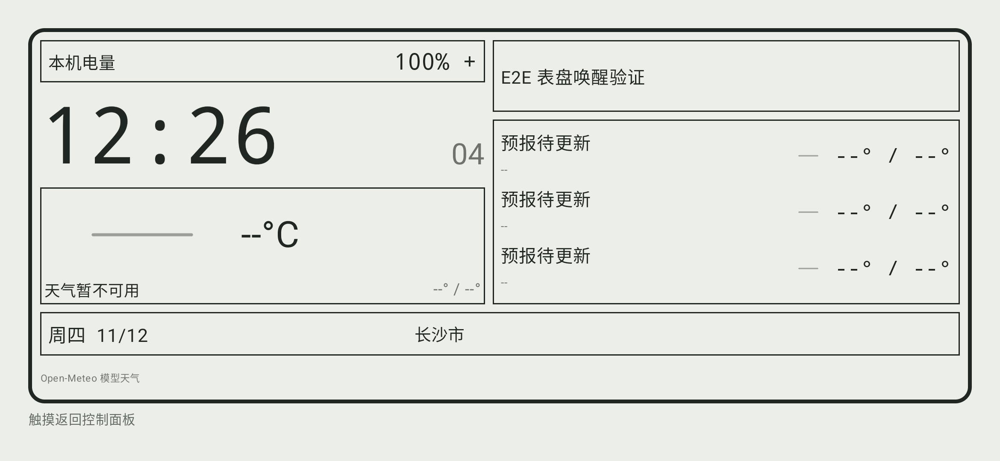
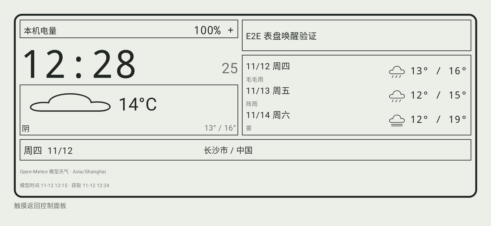

# 阶段二十：同条件真实双端天气重连对照

日期：2026-11-12。对应 DIAL-04、CONN-02 的天气缓存子项及 DIAL-03 的五表盘唤醒子项，不等于这些需求的全部验收通过。本轮只运行隔离集成检查并整理证据，没有修改运行代码、重新构建或覆盖 alpha.2。

## 固定条件与实际包来源

Android 为已发布 alpha.2 的同一个 APK，专用 Android 34 AVD 内已安装文件的 SHA-256 再次核对为 B429B09B7FF21B0986754C5732A99E0934A249786EB75CF1485F8320DABF84E4。没有向实体手机安装。

旧 Windows 包 controlpanel-unified16-win64-r1 的运行基线为 e1153b466；新包 controlpanel-unified19-win64-r1 含 df3791f40 的天气顺序修复，正是 alpha.2 本地内部 ZIP 的运行目录。分别核对了实际守护进程已加载插件的路径：

| 插件 | SHA-256 |
| --- | --- |
| 旧 controlpanel DLL | B6B4DE6C4EC173582CFF411EFA71F6B24AA815BBD746A26CEBE1A985C55B7A8C |
| 新 controlpanel DLL | EFD78F084AE782C6175888A7DDBC6F31539AB6D2F563BB615DFDDE56E632A584 |

使用同一个专用配对配置，旧包全部退出后才启动新包，没有同时运行两个守护进程。新包使用 Offscreen、SelfTest；没有原生可见窗口、主机焦点或实际音频写入。仅测试配置中的 controlpanel 插件启用。

沿用 ADB 5038 / emulator-5580 的定向发现和端口反向通道；TLS 和配对由生产应用完成，不算普通局域网发现或真实多手机验收。

## 真实天气与重连步骤

先把专用测试配置中的旧天气缓存移动到本地证据目录，未删除。打开旧桌面包与 Android 控制屏，以生产编辑器启用长沙市信息表盘，取得新的 Open-Meteo 数据：

- fetchedAt = 1794486278，实际温度 13.8 摄氏度，画面按原规则显示 14°C。
- 三日预报、来源与模型/获取时间一并保存；此数据不是合成回归样本。
- 随后旧包、新包的整个对照及五表盘复跑都保持同一 fetchedAt，未用再次联网刷新掩盖丢包。

对每个桌面包都先显示一次有效天气，再 force-stop 仅专用模拟器中的调试应用。桌面 CLI 确认该设备已不可达后，重启同一个 Android 应用并重新发现，确认恢复可达。守护进程保持存活，使天气全局对象跨连接存活而插件重建。

重新打开控制屏，先禁用并清空城市，再恢复信息表盘与长沙市。保存生产配置，等待默认空闲阈值后的真实界面，核对两端配置 revision、桌面缓存以及新 UI XML/截图。

| 结果 | 旧包 | 新包 |
| --- | --- | --- |
| 两端配置 revision | 均为 71 | 均为 75 |
| 桌面缓存 fetchedAt | 1794486278，仍新鲜 | 同左，未刷新 |
| 手机实际画面 | 天气暂不可用、--°C、预报待更新 | 14°C、城市及三日预报完整显示 |
| Android 接收的有效天气 | 不能用磁盘遗留缓存冒充内存生效 | fetchedAt 与桌面一致 |

旧包错误画面与新包成功画面均保留，不只保存最终成功图。磁盘 panel_weather 可能保留旧值，判断显示是否恢复以当前实际 UI 为准，不仅检查偏好文件存在。

### 旧包实际画面

### 新包相同缓存的实际画面

表盘时钟与获取时间按模拟器当前系统时区显示；预报日期使用天气城市偏移校验。本轮没有切换系统时区，不能据此认定所有时区边界通过。

## 新包五表盘交互复跑

继续在新 Windows 包与同一个 Android APK 上运行已有五表盘场景：digital、analog、weather、info、car 全部通过。

每种表盘均从实际控制屏读取首页测试按钮边界，选择表盘、检查生产配置缓存，超过默认 5000 毫秒后观察实际空闲画面，再触摸该按钮所在位置。第一次触摸只唤醒，五次均没有执行底层按钮。测试执行记录从基线 5 条保持为 5；全部结束后新的在线点击才增加为 6，保留此前记录。测试按钮只执行已知的无窗口探针，不操作用户软件。

本轮没有修改或新增测试断言来迁就结果，没有重新运行 Android 274 项或 Windows 22 项全量测试；这两个全量数字仍属于阶段十九。Lint 493 错误仍未通过。

## 证据、恢复与后续

本地根目录 D:/KDEBuild/unified20-weather-e2e：
- before/cycle-result.json、cycle-info-ui.json、cycle-info-prefs.json 和 ui；旧包的断开/恢复记录、profile-logs。
- after 对应同条件结果及 runtime-plugin.json；新包实际加载来源、断开/恢复记录与 profile-logs。
- logs/live-observation.json、installed-apk-sha256.txt、plugin-hashes.json、comparison-summary.json。
- logs/five-dials.log，after-dials/logs/dial-summary.json 和每种表盘新 XML/截图；after-dials/cache-check.json 证明获取时间未变。
- logs/cleanup.json：完整面板配置除 revision 外与初始完全相同，revision 从 68 正常递增至 87；语言恢复本轮实际初始 zh-CN。清理时先误按此前阶段空列表恢复，比较当前基线后已纠正，不隐去此检查。
- 两个测试包及模拟器进程为 0，专用 ADB 5038 已停止，用户 ADB 5037 和无关 D-Bus 保留。没有删除探针历史或用户文件。

本机编排 E:/git/kdeconnect-tooling/weather-e2e-common.ps1 复用仓库 Invoke-ControlPanelEmulatorUi.ps1、panelemulatorintegration 的 --unified-dial，以及已有 run-unified18-dials.ps1。原始身份配置、证书/私钥、D-Bus nonce 和完整原始日志不上传；仓库仅附无身份信息的产品画面。

已发布 alpha.1/alpha.2 标签、附件及校验值不变。本轮关闭“实际旧/新包同条件天气重连对照缺证据”这一子项；普通 LAN、多设备长时、全部表盘大字体/长文本/无障碍、系统动作/跟随/音频、原 KDE 全功能、Lint、干净 Windows 与第三方发行材料仍未完成。桌面推送和主机可见窗口/焦点/音频写入的确认仍未收到，不擅自执行。
