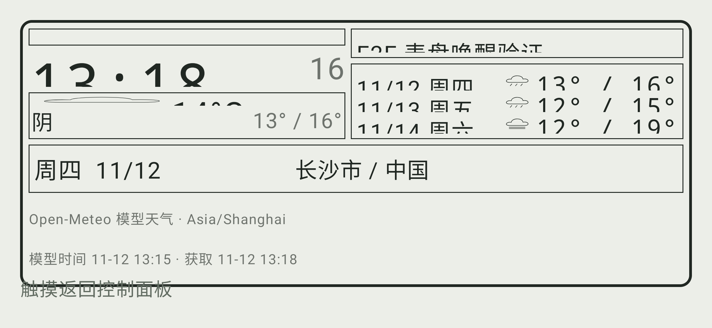
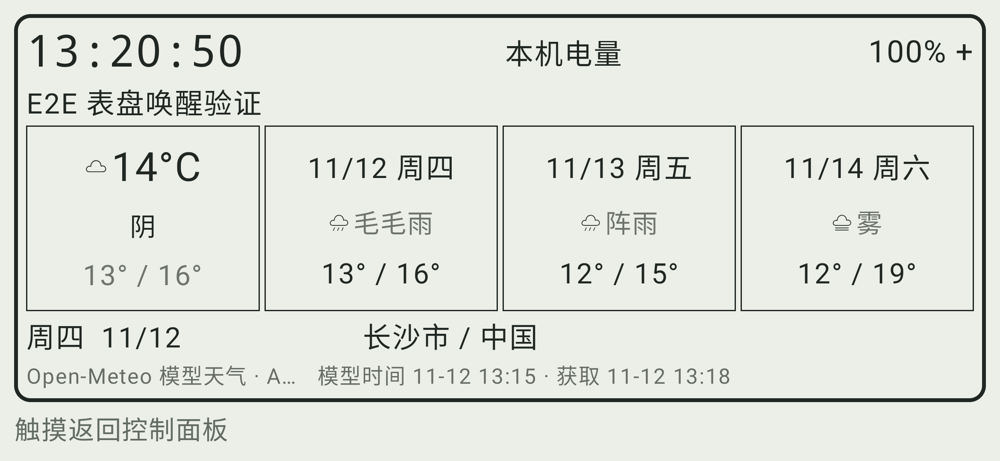

# 阶段二十一：小屏、大字与长文本表盘修复

日期：2026-11-12。仅修改 Android 控制面板的 PanelDialScreen、PanelInformationDial 和新增本地 UI 回归；Windows 运行代码、共享逻辑、其他插件及测试依赖设置均未改动。当前 master 与内部 APK 含本轮修复，已发布 alpha.1 / alpha.2 不覆盖。

## 问题与修复范围

新增检查后，旧实现的首轮 12 项中有 10 项失败（两 SDK）：大字体天气页的来源、日期和个性文本被挤出屏幕；信息页电量、时钟、温度及预报被压成不足一行；更新来源与唤醒提示还会重叠。普通“画面不是空白”不能证明这些文字可读。

共同原因是字号单独调整却沿用 Material 正文行高，同时固定 25dp 的提示预留无法随系统字号增长。修复包括：

- 表盘内部文字按自身字号设置行高，继续使用系统字体缩放，不覆盖 LocalDensity 或全局关闭缩放。
- 唤醒提示采用真实测量占位，安全区仍保留；小屏大字减小外边距并调整天气文字区比例。
- 普通字号保留参考式分区；信息页根据高度和字号，在空间不足时使用电量/时钟、当前天气和三日预报的紧凑排布。正常分区中的时钟按实际单元格高度适配。
- 长城市、个性文本及来源可按空间显示省略号，完整值仍在语义树中；温度、预报数值、获取时间和汽车“非实时数据”说明不以省略代替。
- 配对、协议、天气数据、安全校验、网络重推、空闲计时与首次触摸只唤醒逻辑不改动。电量接收器仍只有原来的一个。

紧凑排布使用适合其空间的基础字级，不承诺每一元素的物理尺寸恰为普通布局两倍；测试明确确认系统 fontScale=2 生效，并检查可见文字而非通过关掉缩放使测试通过。

## 自动回归与失败证据

新增 PanelDialAccessibilityUiTest 最终 20 项，覆盖 SDK 28 / 37、800 x 360 与 640 x 360dp、中英文、默认/两倍字号、120 字符配置城市、260 字符解析城市、240 字符个性文本、缓存/过期/离线天气和合法极端温度。

检查实际文字布局的全部行高、边界和相互重叠；时钟/温度/范围/更新时间/非实时说明的字符不能丢失。另核对完整长文本语义、模拟钟可读时间、无障碍唤醒动作恰好一次、电量、三条预报和来源时间没有被直接删除。它不是 TalkBack 实际朗读或所有无障碍标准的完整验收。

| 检查 | 实际结果 |
| --- | --- |
| 旧实现定向回归 | 12 项中 10 项失败，截图与报告保留 |
| 中间扩展检查 | 保留 640dp 普通/缓存天气的失败，以及测试导入/DSL 接收者编译错误日志；修复后重跑 |
| 最终扩展定向 | 新 20 项 + 既有信息区 2 项，22 项通过，1 分 3 秒 |
| Android 全量 | 45 套件、294 项，失败/错误/跳过均为 0 |
| 完整任务 | testDebugUnitTest、assembleDebug、lintDebug；退出 0，3 分 56 秒 |
| Lint 新生成报告 | 493 错误、211 警告、1 提示，仍未通过；不是任务退出 0 就算通过 |
| Lint 错误分类 | MissingTranslation 472、ExtraTranslation 20、MissingLeanbackLauncher 1；本轮未增加字符串或忽略规则 |
| APK | v1/v2 签名通过；新表盘函数在 DEX 中，新增测试类及测试规则符号未进入 APK |
| Windows 全量 | 本轮未重跑；阶段十九的 22/22 仍是对应历史证据 |

首个测试导入失败不是产品失败。早期泛化的 overflow 标志还会误报完整显示的字符，已在运行代码修复前改成逐行字符/可见高度检查；旧实现随后仍有 10 项真实失败，不以放宽断言掩盖裁切。

## 实际 Android 34 模拟器对照

同一个专用 AVD、同一个 Windows 内部包 controlpanel-unified19-win64-r1、同一配对身份，先运行已发布 alpha.2 APK，再只安装本轮新 APK。两端均采用系统 fontScale=2.0 和中文，配置 revision 都为 88，真实 Open-Meteo 天气 fetchedAt 都为 1794489494，没有用刷新数据或换配置掩盖差异。

旧包实际电量节点只有 20 像素高，14°C 节点只有 35 像素，画面可见截断；新包分别为 90 和 113 像素，电量、温度、状态、三日预报及完整获取时间均可读。来源行在空间不足时仍可省略部分时区，完整来源语义保留，不把它描述为所有长文本都完整展开。

### 旧 APK 的两倍字号实际画面

### 新 APK 的相同设置实际画面

随后在新 APK 的真实两倍字号界面运行 digital、analog、weather、info、car 五表盘选择、默认 5000ms 空闲及首次触摸唤醒。五次唤醒均不执行底层按钮，已有探针记录从 6 保持为 6；之后一次新的在线点击才增加为 7。整个过程获取时间未变化，只有已知无窗口测试探针被执行。

沿用 ADB 定向发现和反向端口，TLS / 配对仍由生产程序完成；不算普通 LAN 发现或实体手机验收。没有向华为手机安装，也没有主机音量写入或可见窗口/焦点测试。时钟仍按模拟器系统时区显示，本轮没有切换时区。

## 产物与本地证据

运行代码提交：9696bc0da61ef4819863f1cffdd37e5ce0442272。后续仅整理文档。

~~~text
D:/KDEBuild/artifacts/controlpanel-unified21-20261112/kdeconnect-controlpanel-unified21-debug.apk
30872225 字节
SHA-256 B5521FA340FDB5027B8CC704C34CA08176D33AAB0E4C46F78EE7B085F7A40814
~~~

这是内部候选，应用 ID 仍为 org.kde.kdeconnect_tp.debug，上游版本仍为 1.37.0-debug、最低 API 23；调试签名，非生产发行。模拟器内 APK 哈希与此产物一致。API 23 的完整显示验收不由 SDK 28/37 测试代替。签名工具仍有既有 META-INF 警告。

证据根目录 D:/KDEBuild/unified21-dial-accessibility：
- logs/focused-before*.log、focused-after*.log、focused-expanded*.log；before / before3 / after1 / after2 / expanded / expanded6 内的报告与截图保留已观察失败。
- expanded7/screens、expanded7/reports：最终定向合成样本；reports-full、logs/android-full.log、apk-signature.log：全量与实际 Lint。
- avd/before、avd/after：实际 UI XML、截图、配置/天气及节点尺寸；avd/logs/live-observation.json 保存真实数据，与本地合成测试分开。
- avd/dials-double 与 five-dials-double.log：五表盘真实触摸检查；cache-check.json 证明获取时间一致。
- avd/logs/cleanup.json：完整配置除 revision 外恢复初始值，revision 从 87 递增至 100；系统字号恢复 1.0，应用语言恢复本轮初始空列表。模拟器保留本轮调试 APK，仅覆盖其旧测试包。
- 启动器有正常会话结束日志，实际退出码未单独保留。首次三秒关闭检查发现残留进程，后续只重查同一批进程，已为 0，没有重启测试；模拟器关闭时的旧 OpenGL 警告保留。专用 ADB 5038 已停止，用户 ADB 5037 和无关 D-Bus 未动。

不上传私有配置、证书/私钥、D-Bus nonce 或完整原始身份日志。仓库仅附无身份信息的自有产品画面。

## 原目标与下一步

本轮只收口已列尺寸/语言下的裁切和基本语义子项，不把 DIAL、UI 或无障碍整项勾选。下一步继续颜色对比度、实际辅助技术、更多尺寸/姿态/手势与参考视觉；普通 LAN、多设备长时、真实系统动作/跟随/音频、原 KDE 全功能、Lint、干净 Windows 和第三方发行材料仍待完成。桌面 fork 推送、主机可见窗口/焦点/音频写入及共享无效后端输入保护的确认尚未收到，不擅自执行。
