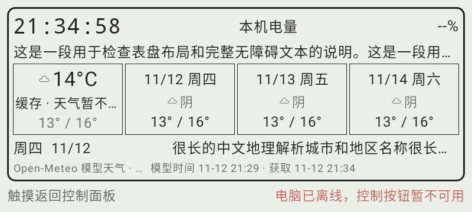
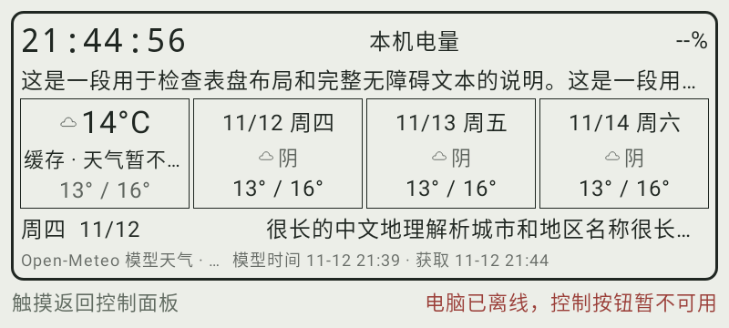
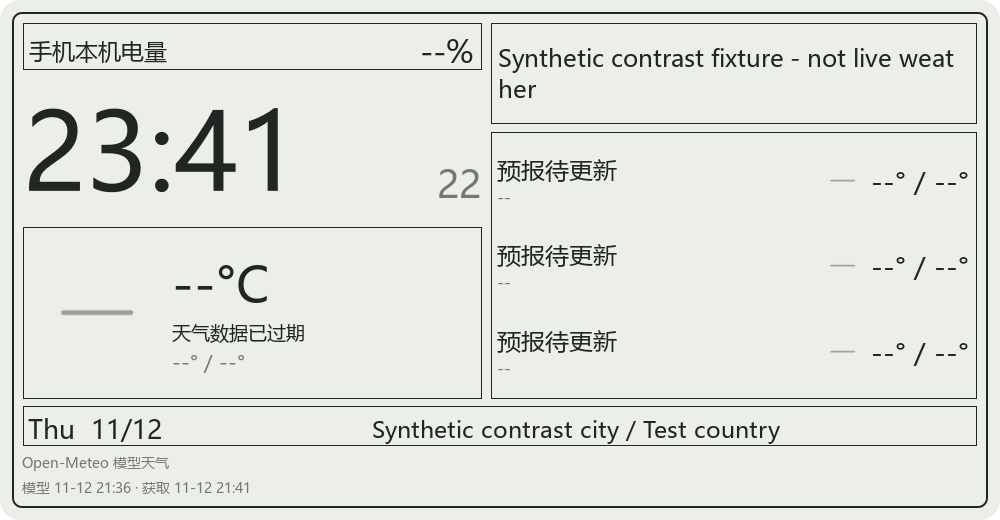
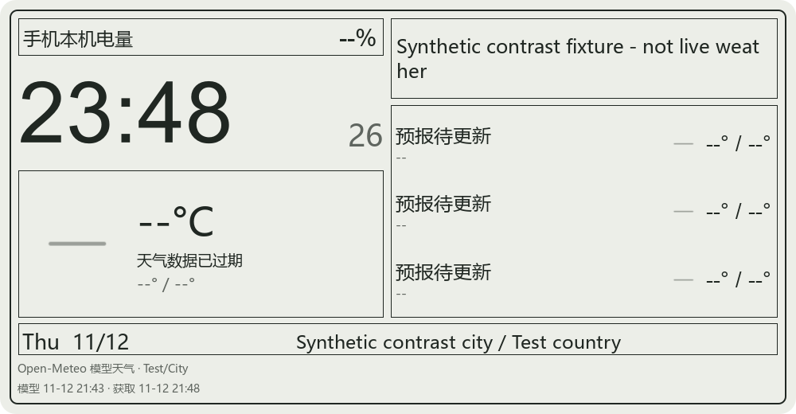

# 阶段二十二：双端表盘文字对比度与首次自检修复

日期：2026-11-12。本轮运行代码改动仅为 Android 表盘三处颜色、Windows 信息表盘一个字色，以及控制面板独立启动器的两个已复现问题。没有修改共享核心、网络/动作/音量逻辑、其他插件或系统环境变量。当前产物为内部候选，已发布 alpha.1 / alpha.2 标签和附件不覆盖。

## 检查口径与最小配色修复

借用 [W3C 文本对比度说明](https://www.w3.org/WAI/WCAG22/Understanding/contrast-minimum.html) 的 4.5:1 门槛，对本轮表盘文字统一采用该值，包括大字；判定不四舍五入。这比说明中大字可采用的 3:1 更严格，但不是对整个原生应用的无障碍合规认证。

Android 从实际 TextLayoutResult 读取字色，以实际绘制的不透明单色背景取样，使用 AndroidX ColorUtils 合成文字透明度后计算。Windows 加载生产 QML，读取可见 Text 的实际颜色、文本 opacity 和父级填充；核对根背景实际截图，并校验父级 opacity=1 的当前模型。不把抗锯齿边缘的浅像素当成声明字色，也不拿写死的预期配色代替实际组件属性。

增加黑白、同色、半透明文字和低于门槛的灰色校准。全部原布局、长文本、数值、更新时间和无障碍唤醒断言保留。

| 修复目标 | 修复前 | 修复后 |
| --- | --- | --- |
| Android 信息表盘次要文字 | 约 4.19861:1 | 约 5.11247:1 |
| Android 浅色表盘离线提示 | 约 3.24438:1 | 约 5.63384:1 |
| Windows 信息表盘次要文字 | 约 3.83053:1 | 约 5.11247:1 |

两端次要字色统一为 #5f655f；Android 只有浅色离线提示使用 #9b403a，黑底提示保持原色。没有改字号、布局或状态含义。表中显示小数仅为阅读方便，原始 TSV 和判断使用未取整比值。

## 实际结果与范围

- Android 修复前定向 22 项有 14 项失败；失败中断部分循环，因此只留下 48 个场景 / 540 条文字记录，其中 64 条低于门槛。修复及校准后 26 项定向通过（表盘 24 + 既有信息区 2），72 个场景 / 806 条记录全部通过；整体最小值为 4.5848637235992:1，不是所有文字都等于新次要字色的 5.11。
- Android 场景包含 SDK 28/37、中英文、640/800dp、默认/两倍字号、最大长度城市/文本、缓存/过期/离线和极端合法温度；本轮未启动 AVD 或安装任何手机。阶段二十一的真实 AVD 检查是前一版证据，不冒充当前新 APK 的设备验证。
- Windows 修复前新检查失败，30 个场景 / 228 条 Text 记录中 42 条不足；修复后同样 30 个场景 / 228 条记录全部通过，最小值 5.112471643692751:1。覆盖五表盘、1000 x 520 与 520 x 280 尺寸、ready/cached/expired 状态；最终补全了由生产校验器接受的合成三日预报夹具。
- Windows 新检查是一个 QtTest 功能项，加初始化/清理显示为 3 PASS，不能当作三个独立功能。最后一轮直接检查耗时约 1.29 秒。
- 本检查针对当前表盘的纯色背景和组件文字；没有据此认定主控制页的用户自选背景/图片、所有 Canvas 图形、辅助技术朗读、系统高对比模式或全部设备都通过。

| 完整验证 | 结果 |
| --- | --- |
| Android 全量 | 45 套件、298 项，失败/错误/跳过 0 |
| Android 任务 | testDebugUnitTest、assembleDebug、lintDebug；退出 0，3 分 36 秒 |
| Lint 重新生成 | 473 Error + 20 Fatal = 493 错误、211 警告、1 提示，仍未通过 |
| Windows 完整构建 | 退出 0；日志明确重新编译 PanelInformationDial QML 缓存/资源并链接 app |
| Windows 全量 CTest | 22/22，通过，35.08 秒 |
| 独立身份就绪回归 | Windows PowerShell 5.1 下 4 项通过 |
| 新 Windows r3 内部包 | 新目录、重启、中文/空格数据路径三轮无窗口自检/截图/清理均退出 0，重启身份不变 |
| APK 与包内容 | APK v1/v2 签名通过，新增 UI 测试符号未进入 APK；ZIP 全部 4132 个条目可读，必需启动文件齐全，无身份文件或测试 EXE |

Windows 全量构建/CTest 对应应用运行代码 440d1dd97；之后的启动器脚本修复独立执行了四项回归、模块加载探针和实际包三轮检查，没有把 CTest 当作脚本测试的替代。一次直接 Qt 检查曾出现字体目录警告，最终按既有 CTest 的系统字体目录设置复跑通过，未改产品字体或压制警告。

## 配色画面：本地合成样本

以下是原始测试截图，不是实时联网天气，也不是同一时刻或逐像素布局对照；时间、预报夹具及测试字体环境可能不同。数值判定依据实际组件颜色和背景，非肉眼猜测。

### Android 修复前

### Android 修复后

### Windows 修复前

### Windows 修复后

## 包自检中发现并修复的两个问题

### r1：D-Bus 注册不是身份已就绪

r1 首个新目录自检报 Missing identity file，随后同次运行已生成非空私钥与证书。只读核对 core/daemon.cpp 后确认：官方代码先注册 D-Bus，再构造 KdeConnectConfig 并生成身份。

只在启动器 SelfTest 分支增加最长约 20 秒的有界等待，要求后台存活且两个文件均非空；后台退出或超时仍失败。保留原 ACL、CLI、模块来源和截图检查，不修改官方守护进程或正常启动路径，也不把非空文件判定等同于 PEM 内容验证。

新增 Test-IdentityReady.ps1 从生产启动器 AST 中只提取该函数，使用合成文件验证：延迟生成两文件、已有文件、缺失超时、后台退出。它不运行完整启动器或创建真实身份。旧 r1 与失败日志保留，没有用同目录重试成功覆盖首次失败。

### r2：旧版 PowerShell 误选 Core 模块

使用产品默认的 Windows PowerShell 5.1 经 Start-Process 启动时，r2 报 Set-Acl 无法自动加载。差分探针确认继承了 PowerShell 7 模块路径：自动加载失败，显式加载当前宿主自带的 Security/CimCmdlets 成功，PSModulePath 保持不变。

[Microsoft 的模块路径说明](https://learn.microsoft.com/en-us/powershell/module/microsoft.powershell.core/about/about_psmodulepath?view=powershell-7.5#starting-windows-powershell-from-powershell-7) 也区分了直接调用和经中间进程启动。早期直接调用 powershell.exe 的诊断成功不能否定此问题；通过 Start-Process 的原场景已分别验证失败与修复。

仅在 Desktop 版 PowerShell 中按其 PSHOME 显式导入内置模块，不重写 PSModulePath，避免影响传给应用或用户按钮脚本的环境。r3 的三轮实际启动均使用 Windows PowerShell 5.1、Offscreen、SelfTest；不是原生可见窗口或全部包生命周期验收。

## 产物与来源

内部目录：D:/KDEBuild/artifacts/controlpanel-unified22-20261112。APK 调试签名，上游应用版本仍为 1.37.0-debug、应用 ID org.kde.kdeconnect_tp.debug、最低 API 23；不作为生产发行。

~~~text
kdeconnect-controlpanel-unified22-debug.apk
30872225 字节
SHA-256 9C46A2FA4ADBBBFD40C85D6C8129300904DAC208D8D051E3DFF43EF1EAE3F064

kdeconnect-controlpanel-unified22-win64-internal.zip
181514179 字节
SHA-256 6329A91B15AF0F42B0D30B4BE4051C7E520ACE31A5BAE77E6D70B8319761E777
~~~

Android 运行代码 f8df64ce1b61b756714f5bed877e8f1dff4f7a97；Windows 应用代码 440d1dd97decc8d130d23749f999acd4751844af，r3 启动器代码 cf9c74401c59fbe46bb1d5e1c4326adebbf64385。后续只整理文档。Windows 解压整个包再运行 Start-ControlPanel.cmd，不只复制 EXE；公共二进制的第三方材料仍未完成，因此 ZIP 只留本地。

r3 app SHA-256 为 907819E94D363302B0A54F0112F5C187E1D8D09A1D97E71F881790F21A10D340。kdeconnectcore.dll 与阶段十九包哈希一致，佐证没有顺带修改共享核心。r1/r2/r3 目录各自保留，不改写旧候选；默认应使用 r3 对应的新内部 ZIP。

## 原始证据与清理

根目录 D:/KDEBuild/unified22-dial-contrast：
- before、after-calibrated：Android 色值 TSV/截图及定向报告；desktop-before、desktop-final：QML 的 30 场景 TSV/截图；logs/contrast-summary.json 保存未取整汇总。
- logs/focused-before.log、focused-after-calibrated.log、desktop-focused-before.txt/.xml、desktop-focused-final.txt/.xml，保留先失败后通过。
- logs/android-full.log、reports-full、desktop-full-build.log、desktop-full.log/.xml；APK 签名仍有既有 META-INF 警告，不称零警告。
- logs/package-smoke-error.log 及 smoke-profile：r1 原失败；package-r2-fresh-error.log 及其空目录：r2 原失败；module-autoload / module-explicit 日志保留差分探针。
- identity-readiness-final/result.json、logs/package-r3-results.json：四项函数回归与三轮实际包检查，模块记录数依次 292/290/290。重启会覆盖同 profile 内上一轮日志，外部逐轮结果/输出日志单独保存。
- smoke-r3-* 与 package-r3-*.png 仅留本地；其中有真实测试身份、私钥/证书和 D-Bus nonce，不上传。仓库只附合成样本图。
- 所有 r1/r2/r3 包内进程已为 0；本轮未启动模拟器、未安装实体手机、未进行主机音量写入或可见窗口/焦点测试。用户 ADB 和无关 D-Bus 未操作。

源码仍在 E，构建、缓存、原始证据及产物在 D。完整目标保持进行：主控制页自定义背景的可读性、实际辅助技术、完整视觉/手势、普通 LAN、多设备长时、原生动作/跟随/音频、KDE 原功能、Lint、干净 Windows、第三方声明/对应源码与最终发行仍待完成。桌面推送、主机原生窗口/焦点/音频和共享无效后端输入保护的确认未收到，不擅自执行。
