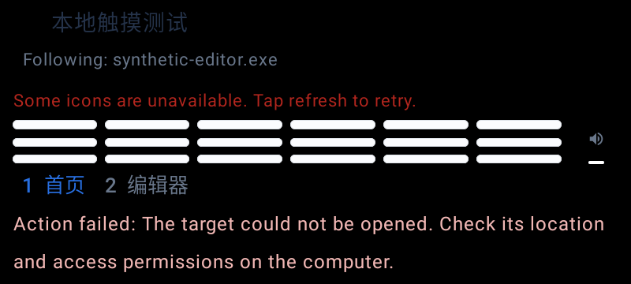
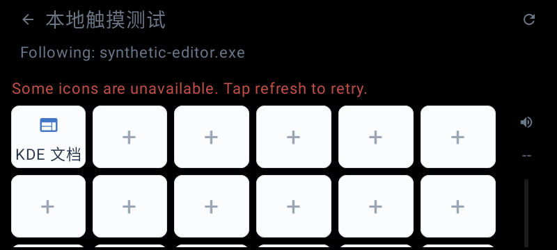
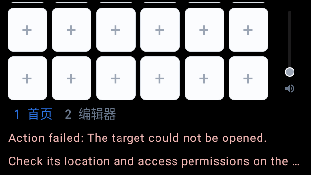

# 阶段二十三：主控制页背景可读性与拥挤布局

日期：2026-11-12。运行代码提交 d6fb02512ba3d894376dd7365552c7348d44284b。仅修改 Android 控制面板界面及其现有测试类，没有改协议、共享核心、动作或音量后端，没有增加依赖。公开的 alpha.3 标签及附件保持不变；本轮修复继续进入 master，不冒充已发布包的内容。

## 需求依据及范围

重新核对本地参考文档和 GKiPdMTUMoEqIAxHt10cdSfzndc 原图，选项为 #RRGGBB 背景颜色、名称显示、音量栏和切页方向；图片用于按钮图标，并非整页背景图片。本轮不增加背景图片功能或改变用户配置。

Android 主控制页的标题、状态、跟随提示、页码和音量数值原来使用固定字色。深色背景下标题可能几乎消失，默认浅色背景的小字也有不足。采用[W3C 文本对比度说明](https://www.w3.org/WAI/WCAG22/Understanding/contrast-minimum.html)中的 4.5:1 作为本轮全部根背景文字的统一检查门槛，不四舍五入；不是对整个原生应用的无障碍合规认证。

## 已复现的问题

- 加入检查后，SDK 28/37 的四个背景测试均失败。完整保留 180 个场景、1260 条文字记录，其中 944 条低于 4.5:1，最低 1:1（背景与字色相同）。
- 黑背景上的标题约 1.65108:1；默认 #F4F6FA 上的跟随/音量/非当前页文字约 4.20827:1，当前页蓝字约 4.37112:1；深主题错误色也不保证适合用户选择的浅背景。
- 两倍字号、图标警告和执行失败提示同时出现时，原加权网格被压缩成细条，音量数值也被裁切。修复前截图保留。
- 最初只预留固定网格高度，随后按标称行高估算也不足。加上“加载图标至少 48dp”后，完整回归中 304 项有两项失败，两 SDK 均实测图标高度仅 40dp。没有删除、忽略或放宽断言；最终改用实际 TextLayoutResult 高度预留标签空间。
- 第一次测试编译另有一个误导入 onAllNodes 的夹具错误，修正导入后才运行上述四项产品失败检查；两者不混为同一问题。

## 最小修复

1. 保留已满足门槛的原字色；不足时沿原色向黑或白方向调整，以实际背景和 AndroidX ColorUtils 原始比值判定。标题、警告、页码、结果及音量文字共用此界面内私有策略。返回/同步和音量图标、活动滑杆也采用相应色，但本轮没有据此认定全部非文本控件对比度通过。
2. 按实际顶部/底部高度和每行图标、标签及内边距保留网格空间。标签高度使用 onTextLayout 的实测值，随密度/字号变化重建。拥挤时整页可纵向滚动，正常空间充足时仍保持原网格填充方式；十八槽位顺序、圆角浅色按钮和原标签省略规则不变。
3. 只给界面内私有 PanelVolume 传入背景色；其监听、节流、音量请求和输出切换逻辑未变。没有修改共享 SystemVolumePlugin。

## 检查覆盖与限制

背景取实际根画布截图角像素，要求与配置一致；前景取生产 TextLayoutResult 字色，不用预期配色替代实际组件。每条文字滚动至可见后检查展示高度；横向页码先定位其纵向页脚，再检查可见性。

- 九种背景：默认浅色、白、黑、深蓝灰、#757575、#767676、纯红、纯绿、纯蓝。
- 五种状态：成功、执行失败、离线、同步中、同步失败，包含图标警告及跟随文本。
- 两组设置：中文默认字号/浅主题；英文两倍字号/深主题。每组运行 SDK 28/37，共 9 x 5 x 2 x 2 = 180 场景，不声称这是语言、主题、字号的全部独立交叉组合。
- 180 个场景的 1260 条根背景文字记录全部达到门槛，最低原始值 4.500065109114417:1。场景和文字记录不是额外独立测试数。
- 额外在 640dp x 360dp、英文两倍字号、黑背景和多条提示下，逐个滚动检查十八槽位至少 48dp；两个切页方向各发送一次正确页面请求，不多发动作。加载图标的两倍字号测试保留标签行高断言，并新增图标宽高至少 48dp。
- 最终定向类 16 项通过。所有网络发送均由固定测试设备截获，不执行电脑动作，不进行真实音频写入。
- 按钮标签位于其独立浅色卡片上，不用整页背景错误计算；本轮根背景颜色统计不包含它们。禁用空槽加号不纳入文字门槛。原图标/标签与离线禁用回归保留。
- 拥挤布局需要滚动，并不保证两倍字号及全部提示同时出现时十八槽位和页脚能在一个屏幕内同时显示。长结果仍可按原规则单/双行省略，语义文本保留；本轮没有实测 TalkBack。任意更大字号、RTL、全部 DPI、非文本对比度和桌面预览仍待独立核验。

## 最终完整回归

最终代码完整执行 testDebugUnitTest、assembleDebug、lintDebug，退出 0，用时 5 分 8 秒，67 项 Gradle 任务中 12 项执行、55 项复用。单元测试和 Lint 报告本次均重新生成，不是以旧报告代替新代码验证。

| 最终检查 | 实际结果 |
| --- | --- |
| Android 单元测试 | 45 套件、304 项，失败/错误/跳过均为 0 |
| 主控制页文字 | 180 场景、1260 条记录，无低于门槛项，最低 4.500065109114417:1 |
| 原表盘文字回归 | 72 场景、806 条记录，无低于门槛项，最低 4.5848637235992:1；不是本轮新增场景 |
| 加载图标与手势 | 48dp 图标、原标签行高、640dp 拥挤布局十八目标及双方向手势全部通过 |
| Lint 新报告 | 473 Error + 20 Fatal = 493 错误，211 警告、1 提示，未通过 |
| Lint 错误分类 | MissingTranslation 472、ExtraTranslation 20、MissingLeanbackLauncher 1；与此前分类一致 |
| 内部 APK | 构建成功、v1/v2 签名通过；含生产 panel-scroll/panel-grid，未含 ControlPanelTouchUiTest 类 |

此前完整 r1 为 304 项通过但未包含图标尺寸断言；r2 为 304 项中两项图标尺寸失败，不能用 r1 代替最终验证。最终完整结果在 full-final 下保存，包含修复后的图标断言。Gradle 退出 0 不等于 Lint 通过，没有补假翻译、压制错误或修改 Lint 配置。

## 合成样本截图

以下为本地自动测试生成，不含用户配对数据，不是实时桌面控制或同一分辨率的逐像素视觉验收。

修复前，800dp 宽、黑背景、两倍字号及失败提示：

修复后，同一类 800dp 场景的顶部，剩余内容需要纵向滚动：

640dp 拥挤场景滚动到页脚，结果仍沿用原双行省略规则：

## 原始证据、产物及未完成项

证据根目录：D:/KDEBuild/unified23-panel-contrast。before 保存原四项失败 XML、180 场景 TSV/截图；logs/focused-before.log 为误导入导致的编译失败，focused-before-compiled.log 才是原界面失败结果。after / after-final 保存初次修复，full-r1-unit-results 是未增加图标尺寸断言的 304 项通过；full-r2-unit-results 和 logs/android-full-r2.log 保存新增图标断言后的两项真实失败。after-measured、focused-measured-results 是最终测量式布局的 16 项定向通过。

最终完整证据为 logs/android-full-final.log、full-final/unit-results、full-final/lint-results-debug.xml、full-final/contrast 与 full-final/screens。文件名前缀 panel- 对应本轮主控制页 180 场景；contrast- 对应既有表盘 72 场景，不混算为 252 个主控制页场景。仓库修复后图片来自最终完整运行。

内部 APK：D:/KDEBuild/artifacts/controlpanel-unified23-20261112/kdeconnect-controlpanel-unified23-debug.apk，30872225 字节，SHA-256 为 325E2A00B9369F13D1E20F7C2B847D99856CEEDAE15A693534F4A295608BFAF9。应用 ID 仍为 org.kde.kdeconnect_tp.debug，版本名 1.37.0-debug、最低 API 23，调试签名，仅本地内部候选，不创建或更新 GitHub Release。

签名日志见 logs/apk-signature.log；既有 META-INF 警告仍保留。原始完整日志也保留 Robolectric HWUI、JDK 和既有 ArrowBack 弃用警告；不据虚拟时钟产生的 HWUI 时长认定真实设备性能。

本轮没有启动模拟器、安装实体手机、运行桌面构建或写入主机音频，也不重复引用阶段二十二 Windows 22/22 作为本轮新测试。源码在 E，构建/缓存/日志/内部产物在 D。桌面推送仍等待用户确认，未执行。

完整目标继续进行：桌面自选背景、真实辅助技术、全部视觉/手势及 DPI、普通 LAN、多设备长时、原生动作和真实音频写入/回滚、KDE 原功能、Lint、干净 Windows 安装卸载、第三方材料、最终配套版本及完整 GitHub 同步均仍需收口。
